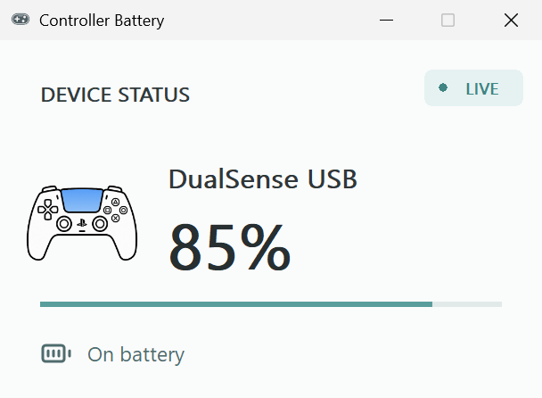
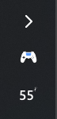

# Controller Battery Tray

[简体中文](README.md) · [English](README.en.md)

See your controller battery in the Windows tray. It appears when the controller connects, disappears when it disconnects, and alerts you when the battery runs low.

**Windows 10/11 · x64 · Current stable release v1.0.2**

[Download installer](https://github.com/AweStudioX/DualSenseBatteryTray/releases/latest) · [Compatibility](#supported-controllers) · [Report an issue](https://github.com/AweStudioX/DualSenseBatteryTray/issues)



*Captured from a USB DualSense on this PC. Battery values are converted from the controller's reported steps; 55% does not imply 1% accuracy.*

## Get started in three steps

1. Download the Windows x64 **Setup.exe** from [Releases](https://github.com/AweStudioX/DualSenseBatteryTray/releases/latest) and run it.
2. Connect a controller. Its icon and battery appear in the tray; click the icon for details.
3. Right-click and choose **Tray layout → Two icons / Compact**. Low-battery alerts fire at 20% and 10%.

Setup includes the .NET runtime and installs for the current user. Uninstall from **Windows Settings → Apps → Installed apps**. The installer is unsigned; you can check its SHA-256 against the file on the Release page.

## What it looks like

Switch layouts by right-clicking the tray icon. Your choice persists across reconnects:

- **Two icons (default)**: separate controller and battery icons, with a percent sign for readability.
- **Compact**: controller and number combined into one icon to save space.

<details>
<summary>Expand real screenshots of both layouts</summary>

| Two icons | Compact |
| :---: | :---: |
|  |  |

These are native-pixel captures from a vertical Windows taskbar. Compact omits the percent sign inside the icon; the tooltip and detail window retain the full value.

</details>

## Supported controllers

| Controller / connection | Status | Battery details |
| --- | --- | --- |
| DualSense · USB | Verified locally | Converted from roughly 10% steps; charging state shown |
| XInput-compatible controllers | Detection supported | Wireless devices generally report only about 0 / 25 / 50 / 100%; some receivers expose no battery |
| Flydigi APEX 4 · 2.4 GHz | Read through the local Space Station service | Requires that service; levels 0–5 map to approximate percentages |
| DualSense · native Bluetooth | Source preview, **awaiting hardware verification** | Not included in the current v1.0.2 installer |
| DualSense Edge, DualShock 4, other Flydigi models | No support commitment | Require separate adaptation and testing |

Unavailable readings show **?**, never a fabricated 100%. Results can vary by model, firmware and receiver. Please include your device and connection method when [reporting an issue](https://github.com/AweStudioX/DualSenseBatteryTray/issues).

## Bluetooth source preview

Current source includes native DualSense Bluetooth report reading, CRC validation and disconnect detection. On Bluetooth connection it reads a calibration Feature Report to request full reports containing battery data. **This has not been tested on a physical Bluetooth connection yet.** First pairing, reconnect, resume and Steam Input coexistence still need testing. [Build from source](#build-from-source) to try it; the v1.0.2 installer does not contain it.

## Build from source

Requires Windows x64 and the .NET 8 SDK.

```powershell
dotnet restore DualSenseBatteryTray.sln
dotnet test DualSenseBatteryTray.sln -c Release
dotnet publish src/DualSenseBatteryTray.App/DualSenseBatteryTray.App.csproj -c Release -r win-x64 --self-contained true -p:DebugType=None -p:DebugSymbols=false -o artifacts/app-publish
dotnet publish src/DualSenseBatteryTray.Watcher/DualSenseBatteryTray.Watcher.csproj -c Release -r win-x64 --self-contained true -p:DebugType=None -p:DebugSymbols=false -o artifacts/watcher-publish
.\scripts\merge-publish.ps1 -AppDirectory (Resolve-Path artifacts/app-publish).Path -WatcherDirectory (Resolve-Path artifacts/watcher-publish).Path -OutputDirectory (Join-Path $PWD artifacts/publish)
.\scripts\install.ps1 -PublishDirectory (Resolve-Path artifacts/publish).Path
```

The Release ZIP also requires its included install script; it is not portable. For a ZIP installation, use the included uninstall.ps1. See [release.yml](.github/workflows/release.yml) for the build and release workflow.

<details>
<summary>How it reads battery data, privacy and credits</summary>

DualSense uses shared read-only HID access; XInput uses its battery-status API; Flydigi queries the local Space Station service. The app does not create a virtual controller, remap input or send lighting, vibration or button-control commands. The Bluetooth preview additionally reads one Feature Report. Logs and layout preferences stay local; device hiding or exclusive access may prevent battery readings.

Battery parsing draws on [dualshock-tools](https://github.com/dualshock-tools/dualshock-tools.github.io), Flydigi service framing on [BatteryMonitor](https://github.com/JKWTCN/BatteryMonitor), and controller artwork on [Fluent UI System Icons](https://github.com/microsoft/fluentui-system-icons). License notices are in [LICENSES](LICENSES). Bluetooth report layout references [Linux hid-playstation](https://github.com/torvalds/linux/blob/master/drivers/hid/hid-playstation.c).

</details>
