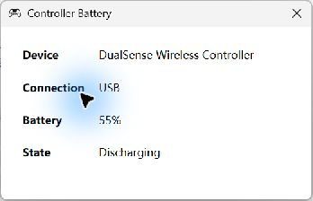
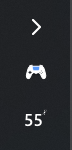

# Controller Battery Tray · 手柄电量托盘

在 Windows 系统托盘直接查看手柄电量与充电状态。提供双图标和紧凑两种布局，适配系统明暗主题；手柄连接后自动显示，断开或停止上报有效数据后自动隐藏。





## 功能

- **电量常驻托盘**：直接查看电量数字，点击图标打开设备、连接方式、电量和状态详情。
- **两种布局**：默认双图标（手柄图标 + 带百分号的电量），也可切换为紧凑单图标；布局选择会保存。
- **低电量提醒**：放电时到达或低于 20% / 10% 提醒，避免重复通知。
- **自动出现与隐藏**：登录后由后台 Watcher 检测手柄；DualSense 通过持续变化的数据判断存活，避免把仍插着的转接器当成开机的手柄。
- **安装与卸载**：Windows x64 安装包自带 .NET 运行时，按当前用户安装，可在 Windows“已安装的应用”中卸载。

## 支持范围与电量精度

| 设备 / 连接方式 | 当前实现 | 电量说明与限制 |
| --- | --- | --- |
| DualSense / USB HID | 支持 | 按手柄上报的约 10% 档位换算；显示 55% 不代表精确到 1%。不包含原生蓝牙支持。 |
| XInput 兼容手柄 | 支持检测；电量取决于设备上报 | 已知无线电池类型可显示约 0% / 25% / 50% / 100% 四档；接收器若按有线设备上报，则显示未知。 |
| 飞智八爪鱼 4 / 2.4 GHz 接收器 | 通过飞智本地后台服务读取 | 依赖空间站后台服务的 fcs.sock 通道及 k2 型号识别；0–5 电量等级映射为近似百分比，充电时可能只有状态而没有百分比。 |
| 其他飞智型号 / DualSense Edge / DualShock 4 | 不作已支持承诺 | 兼容标识不能证明具体型号；需要单独适配和实机验证。 |

上表描述当前代码覆盖范围，不代表全部型号、固件和转接器均已实测。无法读取时显示问号，不会用 100% 代替未知电量。截图来自本机 USB DualSense，未展示其他型号的实测结果。

## 下载与使用

1. 从 [GitHub Releases](https://github.com/AweStudioX/DualSenseBatteryTray/releases/latest) 下载最新 win-x64-Setup.exe。
2. 运行安装包，无需单独安装 .NET；连接受支持手柄后查看系统托盘。
3. 点击图标查看详情；右键可切换布局、刷新，以及管理登录后监听。
4. 卸载：Windows **设置 → 应用 → 已安装的应用 → DualSense Battery Tray**。

安装包当前未签名，可能触发 Windows SmartScreen 提示。请核对下载来源和 Release 附带的 SHA-256。ZIP 是手动安装包，并非免安装便携版。

## 数据与兼容性

DualSense HID 采用共享只读方式；XInput 使用电池状态查询；飞智通过本地后台服务查询电量。应用不发送手柄灯光、震动或按键控制命令，也不创建虚拟手柄。第三方隐藏设备或独占访问可能导致电量不可读，具体游戏共存情况需要按设备实测。

## English

Windows x64 tray battery monitor for USB DualSense and XInput-compatible controllers, with Flydigi APEX 4 readings through the local Space Station service. Includes readable/compact layouts, charging status, low-battery alerts, and automatic visibility based on controller liveness. Support depends on the connection and available battery source; percentages can be coarse estimates.


## Install

Download `DualSenseBatteryTray-v1.0.1-win-x64-Setup.exe` from the [latest GitHub Release](https://github.com/AweStudioX/DualSenseBatteryTray/releases/latest) and run it. This is one per-user installer: it bundles the App, background Watcher, and .NET runtime, so there is no second download or administrator prompt. It installs to `%LOCALAPPDATA%\Programs\DualSenseBatteryTray`, registers the Watcher to start at Windows sign-in, and appears in Windows **Installed apps**. The tray App still appears only while a live controller is detected.

To remove it, use Windows **Settings → Apps → Installed apps → DualSense Battery Tray → Uninstall**, or the Start Menu uninstall shortcut. The installer is currently unsigned, so Windows SmartScreen may show a warning; verify the release download and its `.sha256` checksum before choosing to run it.

The `win-x64.zip` archive remains available for manual installation. It is not a portable edition. Extract it and run:

```powershell
.\install.ps1 -PublishDirectory .\publish
```

This PowerShell route installs the same App, Watcher, and logon task for the current user. If you installed from ZIP, remove it with `uninstall.ps1` from the extracted archive. If you installed with Setup.exe, use Windows Installed apps instead.

## Behavior

- Supported controllers currently include USB DualSense and XInput-compatible controllers. Flydigi receivers are recognized separately when Windows exposes their `FLYDIGI_VADER` or `FLYDIGI_APEX` compatibility identity; other XInput devices use a generic gamepad profile and icon.
- A supported controller uses the readable `Two icons` layout by default at 96 DPI: a controller-specific icon followed by a separate battery value that includes `%`.
- DualSense reports coarse battery steps (roughly 10%); values such as 55% are converted estimates, not 1%-accurate measurements. When XInput exposes a known wireless battery type, the application displays its four coarse buckets as `≈ 0%`, `≈ 25%`, `≈ 50%`, or `≈ 100%`. Some third-party receivers—including current Flydigi compatibility firmware—report themselves as wired; their battery remains `?` instead of showing a misleading 100%.
- Flydigi APEX 4 exposes its real 0–5 battery level and charging state through the Space Station background channel. When its local `fcs.sock` pipe is available, the app identifies the controller as `k2`, uses the APEX icon, and reads that channel without opening or taking over controller input. Without a verified identity source, the receiver is still detected, but its misleading `VADER3` compatibility identity is not treated as an exact model match: the app uses the generic gamepad icon and shows battery as `?`.
- `Compact` remains an optional persisted layout with one controller-and-number icon; it omits `%` inside the icon while hover text and the status window retain the complete percentage.
- Connected tray artwork automatically adapts its outline and number contrast when the Windows system theme changes. Charging never replaces the measured percentage with a fabricated value.
- `Tray layout` in the right-click menu switches live between `Two icons` and `Compact`; the successful choice is remembered across reconnects without restarting the HID session.
- The executable and status window use a separate static, unconnected controller identity with an unlit touchpad and no blue connection indicator.
- Clicking any active tray icon opens the status window; right-clicking opens Refresh, listener, tray-layout, About, and Exit commands.
- VID/PID presence alone is not treated as a connected DualSense. The hidden watcher launches for advancing DualSense reports or an active XInput slot; an idle DualSense adapter that returns frozen reports keeps every tray/window UI hidden.
- When advancing reports stop, the tray application closes and removes its icon or icons after the liveness timeout; the hidden watcher remains available and restores the application automatically when advancing reports resume without requiring a USB reconnect.
- DualSense HID access is shared and read-only. XInput support calls only the battery-status API. The application never sends controller output, feature reports, vibration, lighting, or input commands.
- Controller artwork is adapted from Microsoft Fluent UI System Icons under MIT; see `LICENSES/fluentui-system-icons-MIT.txt`.
- Flydigi local-service protocol framing is adapted from JKWTCN/BatteryMonitor under MIT; see `LICENSES/batterymonitor-MIT.txt`.

## Releases

Pushing a version tag such as `v1.0.1` runs the Windows Release workflow. It tests the solution, publishes self-contained `win-x64` App and Watcher executables, builds and smoke-tests Setup.exe, then attaches Setup.exe, the manual-install ZIP, and a SHA-256 checksum for each to the GitHub Release. A manual workflow run validates the same packages without publishing a release.
